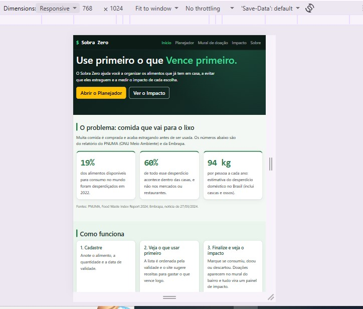
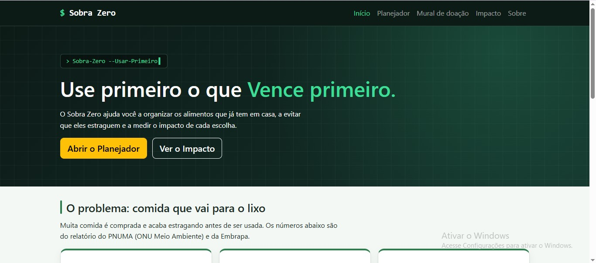

# Sobra Zero — Planejador Anti-Desperdício de alimentos

Projeto da avaliação **Tecnologia Cidadã** de Desenvolvimento Web I.
Tema: **uso consciente de recursos** (Alimentos em casa).

## Objetivo

Ajudar famílias a reduzir o desperdício de alimentos em casa. O usuário cadastra o que tem
na geladeira e na despensa e o site mostra, ordenado pela validade, **o que usar primeiro**, sugere
**receitas** para gastar o que vence logo, oferece um **mural de doação** do bairro e mede o **impacto**
de cada escolha (consumido, doado ou descartado).

## Problema e cidadão

- **Cidadão:** Moradores de áreas urbanas (famílias da Grande São Paulo) que fazem compras para casa.
- **Problema:** Alimentos esquecidos passam da validade e vão para o lixo, o que gasta dinheiro e gera desperdício de recursos.
- **Evidência (dado público):** Segundo o PNUMA (*Food Waste Index Report 2024*), 19% dos alimentos disponíveis
  para consumo foram desperdiçados no mundo em 2022 e 60% desse total ocorreu nos domicílios.
  A Embrapa divulgou a estimativa de 94 kg por pessoa por ano para o desperdício doméstico no Brasil.
- **ODS:** 12 (consumo e produção responsáveis), 2 (fome zero) e 13 (ação contra a mudança do clima).

## Funcionalidades

- Formulário com label, validação nativa do HTML5 e validação em JavaScript (mensagens na tela).
- **Adicionar, listar, editar e remover** itens, atualizando a página pelo DOM.
- Lista ordenada pela validade, com aviso de "usar primeiro" (vence em até 3 dias) e "vencido".
- Filtro por situação do item.
- **Painel de registro de atividades** com data/hora, ação e resultado.
- **O que cozinhar hoje?** Sugere receitas simples cruzando os alimentos cadastrados (os que vencem primeiro têm prioridade) com uma lista de receitas guardada em `js/receitas.js`. Alimentos vencidos não entram nas sugestões.
- **Fim do ciclo:** cada alimento pode ser marcado como **consumido, doado ou descartado** (botões *Consumi*, *Doei*, *Descartei*). Ele sai da lista e vai para o histórico.
- **Painel de impacto** (`impacto.html`): kg aproveitados, valor estimado que não foi para o lixo, kg doados, kg descartados e % de desperdício evitado, mais o histórico.
- **Mural de doação** (`mural.html`): alimentos oferecidos para doação, com filtro por bairro. Só aparece o **bairro** (sem nome, telefone ou endereço).
- Dados salvos no `localStorage` (continuam após recarregar a página). Itens salvos em versões antigas continuam funcionando.
- Layout responsivo (Mobile First) testado em 3 larguras.

## Tecnologias

HTML5 semântico, CSS3 (Flexbox e Grid), JavaScript (sem frameworks), Bootstrap 5.3.3 (navbar, grid, cards e formulário, via CDN) e Git/GitHub.

## Como executar

1. Baixe ou clone o repositório.
2. Abra a pasta no **VS Code**.
3. Instale a extensão **Live Server**, clique com o botão direito em `src/index.html` e escolha **Open with Live Server**.
4. Também funciona abrindo `src/index.html` direto no navegador. É preciso ter internet para carregar o Bootstrap.

## Estrutura de pastas

```
sobra-zero/
├── src/
│   ├── index.html          # Página inicial: problema, como funciona, ODS
│   ├── planejador.html     # Página principal: formulário, lista, receitas e registro
│   ├── mural.html          # Mural de doação do bairro
│   ├── impacto.html        # Painel de impacto, histórico e registro
│   └── sobre.html          # Objetivo, negócio de impacto e privacidade
├── css/
│   └── style.css       # Estilos próprios (Mobile First)
├── js/
│   ├── config.js       # Constantes e limites
│   ├── datas.js        # Funções de data
│   ├── validacao.js    # Regras de validação
│   ├── armazenamento.js# Leitura e gravação no localStorage
│   ├── registro.js     # Painel de registro de atividades
│   ├── receitas.js     # "O que cozinhar hoje?" (receitas e sugestões)
│   ├── planejador.js   # Lógica da página (adicionar, listar, editar, remover, finalizar)
│   ├── impacto.js      # Cálculo do impacto e histórico
│   └── mural.js        # Mural de doação e filtro por bairro
├── docs/
│   └── prints/         # Prints das telas
├── .gitignore
└── README.md
```

As páginas ficam em `src/` e acessam `../css` e `../js`. A ordem dos `<script>` importa. No planejador: `config` → `datas` → `validacao` → `armazenamento` → `registro` → `receitas` → `planejador`.
As páginas de impacto e mural carregam os mesmos módulos de base e leem os dados salvos pelo planejador.

## Modelo de dados

Cada item guardado no navegador tem:

| Campo | Tipo | Regra |
|---|---|---|
| `id` | texto | gerado pelo sistema (letras minúsculas e números) |
| `nome` | texto | 2 a 40 caracteres; letras, números, espaço e hífen |
| `categoria` | texto | uma das categorias da lista |
| `quantidade` | número | de 0,1 a 999 |
| `unidade` | texto | `un`, `kg`, `g`, `L` ou `ml` |
| `validade` | texto | data `AAAA-MM-DD`, de 1 ano atrás até 2 anos à frente (itens do histórico aceitam datas antigas) |
| `doacao` | verdadeiro/falso | `true` se o item é oferecido no mural |
| `bairro` | texto | obrigatório só se `doacao` for `true`; 2 a 40 caracteres, só letras, espaço e hífen (sem números) |
| `destino` | texto | vazio (item ativo), `consumido`, `doado` ou `descartado` |
| `finalizadoEm` | texto | data/hora em que recebeu um destino (ISO); vazio se o item está ativo |
| `criadoEm` | texto | data/hora de criação (ISO) |

**Estimativas do painel de impacto:** o peso das unidades (`un`) e o preço por kg são valores **ilustrativos** por categoria, definidos em `js/config.js`. Não são dados oficiais.

## Segurança e privacidade

- Toda entrada é validada (campo vazio, tamanho, formato e tipo) antes de ser usada.
- Textos do usuário são exibidos com `textContent`, nunca com `innerHTML`.
- Os dados lidos do `localStorage` são revalidados ao carregar a página.
- Mensagens de erro para o usuário são genéricas; o detalhe técnico fica só no console.
- Coleta mínima (LGPD): só dados do alimento e, apenas se houver doação, o **bairro** (o campo não aceita números, para evitar endereço ou telefone). Nenhum dado pessoal é pedido. Aviso de privacidade no formulário e no mural.
- Dados antigos ou adulterados no `localStorage` são revalidados (campos novos, destino e bairro incluídos) e itens inválidos são descartados.
- Não há senhas, chaves ou segredos no repositório.

## Prints das telas

Página inicial nas três larguras testadas (Mobile First):

| Celular (até 767 px) | Tablet (a partir de 768 px) | Desktop (a partir de 1024 px) |
|---|---|---|
|  |  |  |

## Limitações

- Sem servidor: o mural mostra os itens deste navegador e alguns **exemplos fictícios**. Uma versão real precisaria de um back-end, com cuidado extra de privacidade, para conectar vizinhos de verdade.
- Receitas, pesos e preços são **estimativas** simples, feitas para o protótipo.

## Créditos e uso de IA

- Bootstrap 5.3.3 — licença MIT — https://getbootstrap.com
- Dados públicos: PNUMA, *Food Waste Index Report 2024*; Embrapa (notícia de 27/03/2024).
- Este projeto utilizou IA para ajudar na escrita lógica dos arquivos .js e .css, códigos para o git/gitHub e revisão do código.
  A declaração completa está no relatório.
